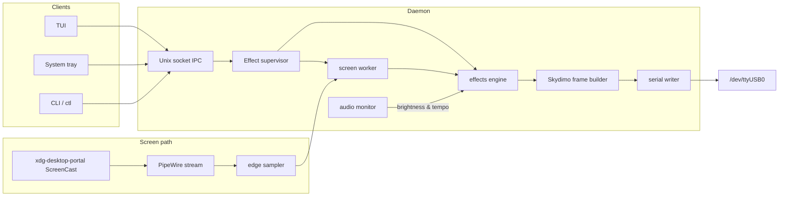

# hyper-sync

Low-latency LED sync for **Skydimo** strips on Linux/Wayland. A single Rust binary drives 65 RGB LEDs over USB serial, mirrors screen edges via **xdg-desktop-portal + PipeWire**, and optionally reacts to system audio — no Node/Bun runtime, no multi-platform baggage.

Built in gated phases (solid → candle → screen sync → systemd) and extended with a background daemon, a TUI with a live strip preview, a tray menu, 46 effects (including ports of Hyperion.ng's) and music-reactive lighting.

## Hardware

| Setting | Value |
|---------|-------|
| Controller | Skydimo (CH340 USB-serial, `0x1a86:0x7523`) |
| Device path | `/dev/ttyUSB0` (typical; verify with `dmesg`) |
| Baud rate | **115200** (8N1, no flow control) |
| LED count | **65** — U-shape: 17 right + 31 top + 17 left (no bottom) |
| RGB order | RGB |
| Data input (LED 0) | **Bottom-right** corner (seated view), counter-clockwise |

At 115200 baud a full frame is ~17 ms on the wire, so **~57 fps** is the ceiling. The controller (model SK0127, answers `Moni-A`) only accepts 115200 — 230400 through 2 Mbaud get no reply.

## Architecture



One process owns the serial port. TUI and tray are thin IPC clients; legacy subcommands (`solid`, `screen`, …) patch the running daemon when it is already up.

## Features

### Daemon & control

- Background **daemon** with hot config reload (`inotify` on `~/.config/hyper-sync/config.toml`): every setting applies live, also from editors that save by renaming
- **Unix socket IPC** — `$XDG_RUNTIME_DIR/hyper-sync.sock`, answered at once
- **`hyper-sync ctl`** — status (plain/JSON), stop, restart, quit, reselect screen, flash, patch settings; invalid values are rejected with a message
- **Serial reconnect** on USB unplug/replug; a stopped effect is retried every 2 s and `serial_ok` reports a missing strip
- LEDs go dark while the screen is locked
- **`hyper-sync install app|service`** — session autostart or systemd user unit
- **`hyper-sync uninstall app|service`** — remove autostart entry or systemd unit

### Effect modes

Our own effects:

| Mode | Description |
|------|-------------|
| `off` | All LEDs black |
| `screen` | Screen edge colors (portal + PipeWire) |
| `screen_center` | Screen sync sampled from center-weighted regions |
| `sound_viz` | Frequency-band visualization driven by audio |
| `solid` | Uniform color (hex or `rainbow`) |
| `candle` | One shared flame flicker with occasional gusts that dip and redden; `warmth` blends the color toward candle amber |
| `fire` | Red at the bottom, orange toward the top; tongues of flame climb both sides |
| `lava` | Wax blobs rising up both sides and meeting at the top |
| `aurora` | Curtains drifting both ways with a shimmer (green → teal → violet with `rainbow`) |
| `pulse` | Slow breathing, one breath per 3 s |
| `flow` | Rainbow drifting around the strip, one lap per 8 s |
| `wave` | Two soft waves rolling around the strip |
| `chase` | Comet with a fading tail, one lap per 2 s |
| `scanner` | A light running up the right side, across the top and down the left, and back |
| `sparkle` | Random sparks that fade out |
| `lightning` | Random strikes with bursts of re-strikes |
| `segment` | Per-segment blocks (right / top / left) |

Ports of [Hyperion.ng](https://github.com/hyperion-project/hyperion.ng)'s bundled effects (MIT, see `LICENSES/hyperion.ng.txt`), following each script's maths and timing at speed 1. Hyperion draws on an image and gives each LED the colour of its patch; here each LED samples that image at its spot on the screen edge. Where a script takes a colour, the accent colour is used; `rainbow` picks the script's default or its random/full-colour preset.

| Mode | Hyperion effect(s) |
|------|-----------|
| `rainbow_mood` | Rainbow mood: the whole strip on one hue, a minute round the wheel |
| `mood_blobs` | Red / Green / Blue mood blobs (accent colour); Full color mood blobs (`rainbow`) |
| `sea_waves` | Sea waves: blue rings from beyond the top-right corner, one cycle a minute |
| `color_waves` | Waves with Color: rainbow rings from the top-left, 90 s a cycle |
| `plasma` | Plasma (Hyperion advanced it by its CPU time, which varies; here 13 s a cycle) |
| `swirl` | Rainbow swirl (`rainbow`, 20 s a turn; "fast" = speed 2.9); Atomic swirl's three arms in the accent colour |
| `double_swirl` | Double swirl |
| `snake` | Snake (accent colour; red with `rainbow`) |
| `knight_rider` | Knight rider: sweeps across the screen width, so each side lights all at once at the ends |
| `juggler` | Juggler |
| `collision` | Collision (including its quirk of rotating the output by bytes, which shifts colours) |
| `traces` | Color traces |
| `trails` | Trails (accent colour) / Trails color (`rainbow`); drops fall down image columns, so on an edge strip they show only now and then |
| `police` / `police_solid` | Police Lights Single / Solid |
| `sparks` | Sparks (accent colour; random colours with `rainbow`) |
| `random` | Random |
| `xmas` | X-Mas |
| `light_clock` | Light clock: hour, minute and second as wedges fading out behind each hand |
| `flags` | Flags Germany/Sweden |
| `breath` | Breath: white fading 20% → 100% over 3 s and back over 1 s |
| `cinema_brighten` / `cinema_dim` | Cinema brighten / dim lights: dim amber up to bright amber over 5 s (or down), then stays — lights up when a film ends |
| `notify_blue` | Notify blue: three blue blinks, then dark |
| `hyperion_fire` / `lights` / `matrix` | Fire / Lights / Matrix: Hyperion's GIF animations played at 25 / 25 / 30 fps. The frames are stored shrunk to 32×18 (`assets/hyperion/*.rgb`, ~210 KB), since the LEDs only ever see each frame's edge zones |
| `led_test` / `led_test_seq` | Led Test / Led Test - Sequence (pair with the LED numbers in the TUI) |

Not ported: **Pac-Man** (a trademarked game character), **Strobe red/white** (strobes were removed on request), **System Shutdown** (a one-off alarm that can halt the machine), **Candle** (ours is one shared flame; Hyperion's flickers every LED on its own, which reads as a flat glow from a distance), **Warm/Cold mood blobs** (base hue wandering in a range; use a red or blue accent). Our own `fire` stays alongside Hyperion's (`hyperion_fire`).

`heartbeat`, `strobe`, `wipe` and `sunrise` were removed, and some effects were renamed (`mood` → `mood_blobs`, `ocean` → `sea_waves`, `juggle` → `juggler`, `clock` → `light_clock`); a config with an old name still loads.

Shared controls: **brightness**, **speed**, **power** (how strongly effects dim, flicker and contrast: 0 = steady, 50% = as designed, 100% = twice that), **FPS** (24/30/45/55), **color** presets + rainbow.

The LEDs go dark while the screen is locked (`org.freedesktop.ScreenSaver`, via `gdbus`) and come back on unlock.

`hyper-sync ctl flash 00ff00 --count 3` blinks a color over whatever is running — handy from scripts and hooks. In screen sync it only shows while the screen is updating.

### Screen sync

- **XDG Desktop Portal** screencast via `ashpd` (KDE Plasma 6 / `xdg-desktop-portal-kde`)
- **Persisted permission** — restore token saved to `~/.config/hyper-sync/restore-token`
- **PipeWire** stream with edge sampling mapped through `config/layout.toml`
- **Smoothing** (`[screen] smoothing`, default 0 = off): eases between frames (time constant 0.6 s × smoothing²) to calm flicker, at the cost of lag
- **Gamma** (`[screen] gamma`, default 2.2): screen colors are encoded for monitors, LEDs are linear — without it mid-tones look washed out. `1.0` turns it off.
- Each LED averages the whole stretch of screen edge up to its neighbours
- Survives resolution changes; **`R`** in TUI or `ctl reselect-screen` / `--forget-portal` to re-pick monitor
- NVIDIA offload env vars documented for systemd (`__NV_PRIME_RENDER_OFFLOAD`, `__GLX_VENDOR_LIBRARY_NAME`)

### Audio-reactive overlay

Works on top of any effect (not just `sound_viz`):

| Setting | Description |
|---------|-------------|
| **Sound mode** | `level`: the whole strip follows the music (bass) · `balance`: each side follows its own channel (left speaker → left side, right → right) and the top the mix, with the stereo difference tripled. With centred audio the two look alike; balance shows with panned sound (games, films, wide-stereo music). |
| **Reaction** (`reactivity`) | How strongly the lights follow the music: quiet passages dim to as low as 30% of your brightness, peaks lift toward 100% |
| **Sensitivity** | Input drive and shaping (how strongly quiet sounds register) |
| **Smoothing** (`[audio] smoothing`) | How slowly the reaction falls back: 0 = snappy (50 ms), 1 = smooth (600 ms) |

With a sound mode on, the music also drives the animation: effects run faster on beats.

- Captures the **default PipeWire sink monitor** via `parec` (48 kHz stereo F32)
- **Bass-weighted** boost (~100 Hz low-pass) so kicks pump without treble flicker
- Soft-knee dynamics + fast-attack envelope
- **`sound_viz`** effect renders a 16-band spectrum (bass right, mids top, highs left), recomputed every ~5 ms from a rolling window — about four periods per band, so treble reacts in a few ms and bass in ~50 ms
- `parec` asks for ~5 ms buffers, which drops PipeWire's cycle from 1024 to ~256 samples while audio is in use

Requires `parec` (PipeWire) on `PATH`.

### TUI

Interactive panel (`hyper-sync tui`) — **`q`** detaches, daemon keeps running. Fits 80×24; **`?`** lists every key.

**Layout:** a live preview of the strip drawn around a monitor outline (what the LEDs show right now, every 5th LED numbered, with the effect, frame rate and connection status inside; in screen sync it shades the part of the screen being sampled) · controls with their keys (left; grouped under light, effect, screen sync and sound when the terminal has 30+ rows) · effects (right): favorites pinned on top, then every effect under its group; `H` marks Hyperion ports. On tall terminals a stats & config panel sits under the controls: frame rate, uptime, an estimate of the LED current (20 mA per channel at full; green under 0.5 A, red from 0.9 A — what a USB 2 / 3 port supplies), strip, screen and config file. Controls an effect doesn't use are dimmed. If the daemon stops answering, the preview says so.

| Key | Action |
|-----|--------|
| `↑` / `↓`, `Enter` | Browse effects — the one under the cursor starts when you pause; `Enter` starts it now |
| `0`–`45` | Jump to an effect by number; `0` is Off |
| `f` | Favorite: start the effect and pin it in the section at the top of the list, under Off, which is always there (again: unpin). Saved in `~/.config/hyper-sync/favorites` |
| `i` | Stats & config panel (always shown under the controls when the terminal has 31+ rows) |
| `e` | Edit `config.toml` in `$VISUAL`/`$EDITOR` (or the desktop's editor); changes apply live |
| `w` / `s` | Brightness up / down |
| `a` / `d` | Speed down / up |
| `z` / `x` | Power down / up |
| `-` / `=` | Cycle FPS preset |
| `←` / `→` | Cycle color preset |
| `c` | Custom color dial |
| `[` / `]` | Candle warmth · screen-sync gamma |
| `{` / `}` | Screen-sync smoothing |
| `Tab` | Cycle sound mode |
| `j` / `k` | Sound reaction down / up |
| `h` / `l` | Sensitivity down / up |
| `,` / `.` | Sound smoothing down / up |
| `R` | Reselect screen capture |
| `Ctrl+R` | Restart daemon effect |
| `q` / `Esc` / `Ctrl+C` | Detach TUI |

### System tray

The icon is the monitor with the strip's glow behind it, greyed while the lights are off. **Click** turns the lights off and back on (to the last effect), **scroll** changes brightness in 5% steps, **middle-click** opens the control panel (TUI).

The right-click menu is built from the live settings: a status line, a *Lights on* checkmark, then **Favorites** (Off plus the TUI's favorites), **Effect** (every effect by group), **Color** (with swatches), and Brightness, Speed, Power, Frame rate, **Sound** (mode, reaction, sensitivity, smoothing) and **Screen sync** (gamma, smoothing, choose another screen). Each submenu shows its current value and marks it inside; changes made in the TUI or `config.toml` show up within a second. Then: open control panel, edit settings file, restart effect, quit.

## Requirements

- Linux with **Wayland** (KDE Plasma tested)
- Rust toolchain
- Skydimo controller on USB serial
- For **screen** mode: `pipewire-devel`, `gcc` (bindgen), portal screencast permission
- For **audio**: `parec` (PipeWire)
- For lights-off on lock: `gdbus` (glib2); for "edit settings": `xdg-open` or `$EDITOR`
- Only to regenerate assets: ImageMagick (icon from `assets/hyper-sync.svg`), ffmpeg (Hyperion GIF frames)

## Build

```bash
./scripts/build.sh
```

Builds with all features (`screen`, `daemon`, `tui`, `tray`) and installs to:

- `~/.cargo/bin/hyper-sync` and `~/.local/bin/hyper-sync`
- App icon: `~/.local/share/icons/hicolor/{scalable,256x256}/apps/hyper-sync.*` (for the menu and autostart entries; the tray has it built in)

On Fedora, `scripts/build.sh` sets `BINDGEN_EXTRA_CLANG_ARGS` for system headers.

Minimal build (no screen capture):

```bash
HYPER_SYNC_FEATURES=daemon cargo build --release
```

## Install autostart or service

After building, pick one way to start the daemon on login:

```bash
# KDE/session autostart — desktop entry only (~/.config/autostart/hyper-sync.desktop)
hyper-sync install app
hyper-sync uninstall app

# systemd user service — enable, start now, restart on failure
hyper-sync install service
hyper-sync uninstall service
```

**App** writes the embedded desktop entry (3 s startup delay so Wayland/portal are ready) and nothing else. **Service** installs `~/.config/systemd/user/hyper-sync.service`, runs `daemon-reload`, and `enable --now`. The unit sets NVIDIA offload env vars and runs `hyper-sync daemon`.

Re-run `hyper-sync install app` after upgrading to refresh the autostart entry.

You can also run `hyper-sync daemon` manually without either.

## Quick start

```bash
# Start daemon (tray icon on KDE)
hyper-sync daemon

# Headless
hyper-sync daemon --no-tray

# Control panel
hyper-sync tui

# CLI status
hyper-sync ctl status
hyper-sync ctl status --json
```

Shared config is created on first start: `~/.config/hyper-sync/config.toml`. Example template: `config/runtime.toml`.

### First-start defaults

| Setting | Default |
|---------|---------|
| Effect | `screen` |
| Brightness | **15%** (0.15) |
| Speed | 1.0× |
| FPS | 30 |
| Solid color | `rainbow` |
| Power | 50% |
| Sound mode | `off` |
| Reaction | 30% |
| Sensitivity | 30% |
| Sound smoothing | 0.15 (~130 ms) |
| Screen gamma / smoothing | 2.2 / off |

Existing config files are not overwritten — delete or edit `config.toml` to pick up new defaults.

## Configuration

```toml
[device]
port = "/dev/ttyUSB0"
leds = 65

[effect]
mode = "screen"
brightness = 0.15
fps = 30
speed = 1.0
power = 0.5          # 0 = steady, 0.5 = as designed, 1 = strongest

[solid]
color = "rainbow"

[candle]
warmth = 0.9

[screen]
monitor = 0
layout = "layout.toml"   # in ~/.config/hyper-sync; installed on first start
gamma = 2.2          # 1.0 = off
smoothing = 0.0      # 0 = off, 1 ≈ 0.6 s fade

[audio]
sound_mode = "off"   # off | level | balance
reactivity = 0.3     # how strongly the lights follow the music
sensitivity = 0.3
smoothing = 0.15     # how slowly the reaction falls back
```

### LED layout

`~/.config/hyper-sync/layout.toml` (copied from `config/layout.toml` on first start) — 65 LEDs, origin **bottom-right**, counter-clockwise:

```
Index 0–16:   right edge, bottom → top
Index 17–47:  top edge, right → left
Index 48–64:  left edge, top → bottom
```

## CLI reference

### Daemon & control

```bash
hyper-sync daemon [--no-tray]
hyper-sync tui
hyper-sync ctl status [--json]
hyper-sync ctl stop | restart | quit | reselect-screen
hyper-sync ctl flash 00ff00 [--count 3]
hyper-sync ctl set --mode screen --brightness 0.2 --fps 30 --speed 1.5 --color ff3300
hyper-sync ctl set --warmth 0.8 --gamma 2.0 --power 0.4 --smoothing 0.3 --audio-smoothing 0.2
hyper-sync install app | service
hyper-sync uninstall app | service
```

### Direct modes (standalone or IPC patch when daemon runs)

```bash
hyper-sync solid  --port /dev/ttyUSB0 --leds 65 --color ff3300 --brightness 0.15 --fps 30
hyper-sync candle --port /dev/ttyUSB0 --leds 65 --warmth 0.9 --speed 1.0 --fps 30
hyper-sync screen --port /dev/ttyUSB0 --leds 65 --fps 30 --brightness 0.15 --monitor 0
hyper-sync screen --forget-portal          # clear saved screencast permission
hyper-sync off    --port /dev/ttyUSB0 --leds 65
```

### Screen capture permission

First run opens the portal picker — allow persistence when prompted. Press **`R`** in the TUI (or tray **Screen sync → Choose another screen…**) to clear the saved token and open the picker again. Revoke in KDE: **Settings → Privacy → Screen Sharing**.

## Protocol

Skydimo frame (not standard Adalight — **no checksum**):

```
[0..2]  'A' 'd' 'a'     (0x41 0x64 0x61)
[3..4]  0x00 0x00
[5]     led_count       (0x41 for 65 LEDs — raw count, not count−1)
[6..]   R,G,B × N       (195 bytes for 65 LEDs)
```

Total: **201 bytes** per frame.

## Performance notes

| Metric | Target |
|--------|--------|
| Update rate | The set rate is held up to ~57 fps (serial-limited at 115200): measured 45.0 at 45 and 55.1 at 55, for effects and screen sync. The frame loop sleeps only what's left of each interval. |
| CPU | Daemon ~2.5% of one core in screen sync; TUI ~0.3% idle |
| Screen lag | One serial frame (~17 ms) plus up to one frame interval; screen smoothing adds its fade on top |
| Sound lag | ~30–45 ms from sound to light (estimated from the buffer sizes: ~5 ms PipeWire cycle, fast-attack envelope, frame wait, 17 ms serial) |
| Robustness | Survives USB replug, PipeWire restarts, config hot-reload, stream resize |

## Phased delivery (original plan)

| Phase | Deliverable | Status |
|-------|-------------|--------|
| 0 | Rust scaffold, Skydimo protocol, serial writer | Done |
| 1 | Solid color + off, 30 Hz loop | Done |
| 2 | Candle effect | Done |
| 3 | Portal + PipeWire screen edge sync, layout remap | Done |
| 4 | Systemd user service | Done |
| + | Daemon, TUI, tray, animated effects, audio overlay | Done |
| + | Frame pacing, audio spectrum fix, gamma, Hyperion ports, favorites, stats panel, live tray menu, new icon | Done |

## License

MIT. The Hyperion.ng effect ports and the frames derived from its GIFs (`assets/hyperion/`) carry Hyperion's MIT notice in `LICENSES/hyperion.ng.txt`.
